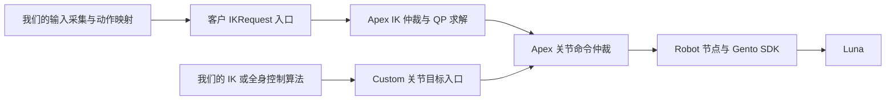

**Luna 遥操二次开发可行性与源码需求**

调研日期：2026-11-18。覆盖用户给出的 Gento 当前版页面、关联的 ROS 2、输入模式、XR、相机、末端、录制与回放、数据转换、VLA 文档，以及上一轮查到的 SDK、ROS 控制代码和模型。依据公开文档、仓库目录、源码和 Release；未连接机器人、未编译整套系统、未验证实机行为。

**判断：可以开发新的遥操程序，不需要先取得完整 Apex 源码；但目前公开资料不足以直接重建、修改和维护整套原厂遥操系统。**

已有配套 Apex 的 Luna，可以通过客户 ROS 接口接入新输入设备、新交互程序和自研算法。独立于 Apex 的控制程序也有 SDK 基础。需要向厂家索取的第一项是与设备匹配的开发包和完整接口约定；只有需要修改、复用其内部实现时，才需要对应模块源码。若选择自行重写这些模块，也能不依赖原厂源码，但须承担输入采集、标定、运动映射、求解、视频和运行管理的开发工作。

| 我们要做的事情 | 现有资料能支持到哪里 | 是否需要索取源码 |
| --- | --- | --- |
| 新遥操界面、键鼠/手柄/主从设备接入，继续使用 Apex 控制后端 | ROS 状态、控制输入、模式切换和录像接口已有说明 | 不要求整套源码；需要配套消息包、可运行示例和接口细节 |
| 自己生成末端/身体目标，继续使用原厂 IK/QP 求解器 | 有客户 IKRequest 入口和输入源切换 | 不要求求解器源码；需要 Luna 对应的请求示例、坐标和有效位定义 |
| 自己做动作映射、IK 或全身求解，输出关节目标 | Custom 接口覆盖双臂、BODY、HEAD | 不要求原厂算法源码；我们承担所替代算法及轨迹约束的实现 |
| 不运行 Apex，直接用 SDK 控制机器人 | SDK 4.7.1 有源码、Python 包装、运动学和控制示例 | 不要求 Apex 源码；需补齐独立底盘、末端、输入与视频方案 |
| 修改原厂头显 App、原厂重定向/QP、Backend/UI、相机或回放内部逻辑 | 有产品和接口文档，但未找到完整配套应用源码 | 要求提供对应模块源码及构建环境，或自行重写 |
| 原样构建并长期自行维护完整 Apex | 公开源码与二进制交付内容不齐全，部分版本不匹配 | 需要完整配套源码、依赖、配置和构建/发行说明 |

**这次相对上一轮的重要修正**

用户提供的 [Gento 当前版页面][current] 来自 `Gento-Teleoperation-Apex` 站点，内容比上一轮使用的 `KLMmotion` 站点更新。该页面主要是操作手册，开发能力应以关联接口页和实际交付版本判断。

| 项目 | 本次核查结果 | 对开发的影响 |
| --- | --- | --- |
| ROS 接口基线 | [Gento 接口页][interfaces] 明确为 `v1.1.7.1g`，SDK `4.7.1`，默认 `/tj` 命名空间 | 新代码不要直接照搬上一轮未带 `/tj` 的路径 |
| 新版交付 | [Release Notes][release] 为 Core `v1.1.7.4g`、Common Runtime `1.0.4`，SDK `4.7.1` 随 Core 提供 | 文档基线与最新安装包不是同一个版本号，需核对现场版本；本次没有升级设备 |
| 底盘 | 已列出 `/move/ManualMoveCmd`、`/controller/odom` 和底盘模式服务 | 上次“未找到底盘接口”的结论仅适用于旧资料；新接口仍需底盘模块和协议细节 |
| 相机 | 已列出单路 NV12、单路 H.264、拼接 JPEG/H.264 和可选深度接口 | 可基于 ROS 接图像开发，无需先改相机程序 |
| 数据文件 | 新版 [Data-Processing-Tool][data-doc] 明确使用状态 MCAP＋视频 MCAP | 上次 MCAP＋MP4＋首帧 YAML 属于旧版格式，不能用作新版统一约定 |
| SDK 获取 | `Gento-SDK` 默认 `main` 仍是较旧内容，但公开有 `v4.7.1` tag | 应选择匹配 tag，不能只 clone 默认分支就认定拿到了新版 |
| DAgger | 文档源码存在，但 front matter 为 `draft: true`，且要求专门交付版本 | 不能作为普通 Luna 已提供人工接管功能的证据 |

**可以利用的三条开发路径**

**1. 输出位姿，复用 Apex 的求解与控制链**

[Gento ROS 接口][interfaces] 和 [输入模式文档][modes] 明确允许 VLA 或客户程序向 `/tj/control/ik_request/vla` 发布 `marvin_msgs/msg/IKRequest`。这里的 `vla` 是入口名称，文档并没有把调用方限定为某种模型。



位姿路径的模式组合为 `set_ik_input=2`，再 `set_input=1`。因此不是所有自研程序都应选择 Custom；只有直接输出关节目标的路径使用 Custom。

公开的 [IKRequest 消息][ikrequest] 包含左右手、肘、躯干、头、骨盆、脚、膝位姿，`bool[11] available` 和 `JointState`。它提供数据结构参考，但还不足以构成可直接使用的 Luna 完整示例：坐标系、标定变换、有效位对应顺序、未控制部位的处理、`joint_state` 的用途与时间戳约定，需要厂家配套示例或实机接口补齐。

这条路径适合自研操作方式、设备映射和末端目标生成。它继续依赖原厂求解器；若要改求解目标、内部约束或避碰策略，需要其源码/扩展接口，或改走自研关节目标路径。

**2. 输出关节目标，使用 Custom 接入自研算法**

| 接口 | 内容 |
| --- | --- |
| `/tj/control/user/joint_cmd_A` | 左臂 7 个关节，`JointcmdArm` |
| `/tj/control/user/joint_cmd_B` | 右臂 7 个关节，`JointcmdArm` |
| `/tj/control/user/joint_cmd_body` | Luna 的 6 个 BODY 关节，`JointcmdBody` |
| `/tj/control/user/joint_cmd_head` | `JointcmdHead` 数组长度 3，当前使用前两个 HEAD 值 |
| `/tj/control/set_input` | 选择 `3=Custom` |
| `/tj/control/set_ik_input` | 按输入模式文档，Custom 路径将 IK 来源设为 `0=Idle` |
| `/tj/joint_states`、`/tj/info/joint_feedback` | 反馈，用于初始化目标、跟踪误差和数据记录 |

按接口文档，在 Robot Ready、机型对应模式与 Home 条件满足后，持续发布带当前时间戳的完整目标。Luna 的旋转关节目标使用 rad；直接调用 SDK 时位置指令使用度，需按各接口单位处理。

这条路径允许我们替换动作映射、IK 和全身求解器。由控制链可知，Custom 在关节层接入，不能假定目标还经过原厂 QP 的约束和避碰处理；保留的检查、限位和失联行为应向厂家明确。输入仲裁和 SDK 本身不能代替我们所替换的算法。

若复用原厂头显，可读取 `/tj/control/target_poseL/R`、`vr_body`、`vr_joy_L/R` 和 `enableL/R`。其中 `target_poseL/R` 已是手柄映射后的目标，不能视为未经处理的原始追踪位姿。若希望重写最前端标定和映射，需要确认原始数据出口，或自采输入设备数据。

客户端使用文档规定的客户输入和切源服务。运行 Apex 时，不直接发布最终 `/tj/control/joint_cmd_*`，也不通过内部 Mux 接口争夺控制权。

**3. 直接使用 SDK，建立自己的机器人侧程序**

已确认 [Gento-SDK v4.7.1][sdk] 公开包含 C/C++ 源码、Python 包装、控制示例、Luna 主体正逆运动学和编译脚本，并提供 amd64/arm64 的 Debian 包。其 [SDK README][sdk-readme] 将 PD 模式明确列为适合遥操的低延时跟踪模式。

因此，“我们能否自己写程序向 Luna 发运动指令”已有实现基础，无须等待 Apex 全套源码。SDK 并不等于完整遥操应用：操作者数据采集、标定、动作映射、全身协调、视频反馈、底盘和设备管理等仍须实现或接入。独立 SDK 程序还需取得与实体机匹配的固件、INI、URDF、工具坐标和限位配置，并作为唯一机器人连接所有者运行。

不应把 SDK 源码的开放范围理解为机器人控制器固件也已公开。本次评估的是用户侧遥操应用开发。

**公开源码与文档逐项核查**

| 模块 | 已核实的公开内容 | 开发边界 |
| --- | --- | --- |
| [Gento SDK 4.7.1][sdk] | `C_SDK`、`PYTHON_SDK`、C/Python 示例、LunaBodyKinematics | 可以直接研究和调用；仍需匹配控制器版本 |
| [gento_ros2_packages][ros] | `marvin_msgs`、`marvin_description`、`marvin_ros2_control`；CMake 实际构建 `marvin_robot_node.cpp`＋`marvin_robot.cpp` | 是消息、模型和底层控制参考；不包含完整 Teleop、两级 Mux、QP、Backend、相机、回放系统 |
| [Apex Core 发行仓库][core] | README、安装与发行说明；Release 提供 DEB | README 明确“仓库为二进制发行”；不能据此取得整套源码 |
| [XR 头显仓库][xr-repo] 与 [Pico 手册][pico] | APK 发行、安装使用、UDP/TCP 选择、端口/偏移配置 | 未发现可构建的 Unity 工程或完整追踪数据包协议；重写兼容客户端需补接口或索取工程 |
| [Apex UI 仓库][ui-repo] | 发行入口；所查 main 没有前端工程 | 新建自己的 UI 可走公开 ROS 接口；修改原 UI 需要源码。复用其 HTTP/WebSocket 时需正式 API 文档 |
| [相机文档][camera-doc] 与 [相机发行仓库][camera-repo] | 单路/拼接图像、深度、WebRTC 地址和房间、录制接口 | 读图像足够起步；完整信令报文、时间戳/编码细节、改编码和传输需要进一步资料 |
| 相机源码链接 `gmsl_quadcam` | Camera README 指向该仓库，本次匿名 GitHub API 返回 404 | 只能判定公开不可访问，不能认定项目不存在；需要向厂方申请访问或替代方案 |
| [ApexTool][tool-doc]、[DM CAN 协议][dm-doc]、[独立夹爪示例][omni] | ROS 命令/反馈、CAN 帧定义、USB 与 SDK 透传示例 | 标准夹爪二开有依据；Luna 内走线需要 Robot 的末端通道桥，空 vCAN 不等于物理连通 |
| [Wuji 二代接口][wuji-doc]、[手套遥操代码][wuji-code] | 20 关节用户控制接口；另有 MIT 许可的手套遥操应用源码 | 二代以太网手与一代接口不同；手套仓库当前 README 标为测试版、未完成实机验收，并依赖厂商 SDK |
| 底盘 | [Gento 接口][interfaces] 列出 `TwistStamped` 速度输入、里程计、`move/msg/State` 和模式服务 | 可以设计适配器；尚缺配套 `move` 包、坐标/限速/失联/控制权详细契约，未确认底盘实现源码公开 |
| [Gento Replay][interfaces] | 命名录制/回放服务、状态 Topic | 可以集成流程；修改内部录制/回放逻辑需配套实现或重写。旧录制白名单说明不可直接套到新版 |
| [数据转换文档][data-doc] 与 [Data-Processing-Tool][data-repo] | 双 MCAP 格式与 LeRobot v3 转换流程，交付 Windows EXE；仓库所查 main 只有 README | 可自写采集/转换程序；要修改其桌面工具需源码，自动化调用接口尚未核实 |
| [VLA Host 手册][vla-doc] 与 [公开 vlahost][vla-code] | 手册明确限定 Marvin Pro 关节模式；公开旧代码仍为 EEF/夹爪桥 | 不能直接当 Luna 全身可用开发包；完整说明见下文 |
| [Luna 模型][models] | URDF/MJCF、mesh，README 声明 CC BY 4.0 | 可用于建模和自研求解，须选择实际机身、臂展、末端对应模型 |
| 上一轮第三方 IO Bridge | [项目说明][io-bridge] 针对 Marvin M6 CCS/旧 SDK；[IO 适配文档][io-doc] 的详细 ROS 章节需授权 | 适合作桥接参考，不作为 Luna 全身即用方案 |

**不能忽略的源码与版本差异**

1. **公开 ROS 驱动与 SDK 4.7.1 至少有一处明确的调用签名不一致。**

   公开 ROS 提交 `e6696ca` 的 [marvin_robot.cpp 第 314 行][ros-call] 使用：

   ```cpp
   FX_L1_Runtime_SetJointPosCmd(FX_OBJ_ARM0, joint_cmd_A_deg);
   ```

   SDK `v4.7.1` 提交 `99da61c` 的 [L1Robot.h 第 1269 行][sdk-declaration] 声明为：

   ```cpp
   FX_L1_SDK_API int FX_L1_Runtime_SetJointPosCmd(
       unsigned int thread_id, FXObjType obj_type, double pos_cmd[7]);
   ```

   后者要求额外的 `thread_id`。所查 ROS 头文件直接包含 `L1Robot.h`，没有发现为这一调用提供的兼容包装。此处为静态源码对照，未做完整编译；至少说明两者不能当作已经配套验证的现成工程。需要兼容分支/适配说明，或由我们修正并验证。**这不妨碍我们通过现场已安装 Apex 的 ROS 客户接口另写程序。**

2. **公开消息结构不等于已经交付的完整接口契约。**

   `IKRequest.msg` 有字段，但新版本的单位、基座坐标、有效位、时间戳、QoS、完整帧要求仍需配套说明。文档所列 Luna QP 500 Hz 是内部设计值，不是对 Custom 程序发布频率的统一要求。旧源码中的 100 ms 检查也不能直接当作新版本整条链路的超时保证。

3. **VLA 文档和代码有跨产品、跨版本差异。**

   `vla-host` 手册开头明确仅适用于 Marvin Pro 关节模式；公开 `vlahost/server.py` 的 `ActionRequest` 则只有 `eef_left/right`、`gripper_left/right`，仍发布旧 `/control/target_poseL_model` 等接口。它不能证明存在 Luna 全身 Joint/EEF HTTP 接口。

   仓库中的 [Gento DAgger 文档源码][dagger] 虽描述了新 Host、人工接管与恢复接口，但标注 `draft: true`，且声明仅适用已交付 DAgger 功能版。它只能作为向厂家询问配套能力的线索。

4. **原厂录制与前端转发可能有范围限制。**

   [Topic 白名单文档][whitelist] 区分录制、回放、WebSocket 和诊断日志，部分旧实现的白名单写死在代码里。新版 Gento 又推荐 `gento_replay`。新增我们自己的观测/动作 Topic 时，需要确认当前录制实现能否配置；也可独立订阅并记录公开 ROS 数据。不能只改一份 YAML 就假定所有链路都会处理新 Topic。

5. **源码可见与使用许可需要分别确认。**

   所查 ROS 包 `package.xml` 的许可证仍为 `TODO: License declaration`，SDK tag 未见根许可证文件。若要把这些源码修改后纳入交付，应向厂家确认允许的修改和分发范围；这一点不等于需要索取尚未公开的完整 Apex 源码。

**建议向厂家索取什么**

优先要一份能验证接口的配套开发交付物，避免只拿到更多操作截图或一个与设备不同版本的仓库地址。

| 优先级 | 索取内容 | 为什么需要 |
| --- | --- | --- |
| 首先 | 实际 Luna 的 Core/Runtime/SDK/固件/Camera/Tool/头显版本清单及对应源码 tag/包 | 固定开发基线，明确当前机器能用哪些接口 |
| 首先 | 同版本 `marvin_msgs`、`move` 等开发包，以及可运行的 Python/C++ 最小示例 | 在独立工作空间构建我们自己的程序，避免复制过时消息和驱动 |
| 首先 | Luna 全身 Custom 示例、IKRequest 示例；模式切换、关节顺序/单位、TF、有效位、时间戳、QoS、发布频率与超时动作 | 形成可执行的客户端契约；特别确认 Custom 保留哪些检查 |
| 首先 | URDF/INI/TCP/相机标定；底盘命令坐标、速度限制、超时与控制权说明 | 让自研算法与实体设备对应 |
| 按需求 | 头显原始数据出口，或完整 TCP/UDP 会话与追踪协议、WebRTC 信令、接收示例 | 使用自研头显/浏览器客户端，或完全重写追踪标定和映射 |
| 按需求 | 新版录制数据样本、状态和视频 schema、时间同步说明、全身动作/观测映射 | 接入我们自己的数据平台与回放/训练流程 |
| 修改原厂实现时 | 对应模块源码、精确 commit、依赖锁定和构建说明 | 修改、排障并维护原厂实现，而不是仅调用接口 |

如果确实需要源码，按实际修改范围提出以下模块清单：

- 输入与动作映射：`controller_udp.py`/VR reader、`teleop_manager_v2`、标定与 `tracking_base_tf`，以及需要修改的 Unity XR 工程。
- 运动链：`ik_request_mux`、`qp_controller`、`joint_cmd_mux`、当前 Gento Robot 节点及 Luna 参数/碰撞模型。
- 产品与数据链：Backend/UI、`gmsl_quadcam` 与 WebRTC、`gento_replay`、Luna 版 `vlahost`；仅索取计划修改或独立维护的部分。

可直接整理给厂家的一段需求（本次未发送）：

> 我们计划在 Luna 上开发自有遥操输入、运动映射和数据采集，第一阶段通过你们正式支持的 ROS 2 客户接口接入。请提供与交付机器一致的版本清单、消息开发包，以及 Luna 全身 Custom 和 IKRequest 两条路径的最小可运行示例；说明坐标系、关节顺序/单位、有效位、时间戳、QoS、控制周期、超时与切源行为，并提供底盘、末端、相机及双 MCAP 样例。公开 ROS 驱动调用与 SDK 4.7.1 存在函数签名差异，请指定兼容代码版本。另请列明头显接收/标定、全身 QP、输入仲裁、相机、回放、Backend/UI 各模块可提供的源码或稳定扩展接口及使用授权。我们需要修改哪些模块后，再确认对应源码交付范围。

**建议的开发起点**

先围绕正式 ROS 客户接口搭一个独立适配层：读取型号和全身反馈，以当前姿态初始化完整目标，验证 Custom 或 IKRequest 中的一条路径，再接入自己的输入设备。与之并行验证相机读取和短段数据采集。PoC 应证明控制源切换、目标连续性、反馈新鲜度、客户端断流后的行为，以及数据和视频实际可读取。

已有 Apex 时，建议优先复用 Robot、相机和末端运行组件，把开发集中在我们要改变的遥操行为上。若目标是完全独立部署，则以 SDK 4.7.1 为底层，单独评估重写全身算法、头显/视频、底盘和运行管理的工作量；当前公开资料不支持把“完整 Apex 可直接从源码构建”作为项目假设。

**证据版本记录**

- 文档仓库：`Gento-Teleoperation-Apex/Apex_doc_center`，核查提交 `b504d68d1fcc30a55cf12bca76a8e18f42a40a19`。
- ROS 仓库：`Gento-Teleoperation-Apex/gento_ros2_packages`，`main=e6696cae3d95d84d1c14d0028ee267620bad9053`；本次分支列表仅有 main，tag 列表为空。
- SDK：`Gento-Teleoperation-Apex/Gento-SDK`，`v4.7.1=99da61cb7c2c1eba5fd4f220bb984b4d8c425e73`；同时核查了版本对应 README、头文件和源码目录。
- Core：发行说明称 `v1.1.7.4g`，对应公开 Release tag 为 `v1.1.7.4gento`；核查了 Release 资产列表，未下载或安装约 291 MB 的 Core DEB，未检查其内部是否包含个别 Python 源文件。
- 未公开的判断限于本次匿名可访问的仓库与文档；不等于厂家没有内部源码，也不排除安装包带有部分脚本。

[current]: https://gento-teleoperation-apex.github.io/Apex_doc_center/software/apex-teleop/gento-current
[interfaces]: https://gento-teleoperation-apex.github.io/Apex_doc_center/software/apex-teleop/gento-interfaces
[modes]: https://gento-teleoperation-apex.github.io/Apex_doc_center/software/apex-teleop/operation-modes
[release]: https://github.com/Gento-Teleoperation-Apex/KernelMind_Apex_Deb/blob/main/docs/RELEASE_NOTES_v1.1.7.4g.md
[sdk]: https://github.com/Gento-Teleoperation-Apex/Gento-SDK/tree/v4.7.1
[sdk-readme]: https://github.com/Gento-Teleoperation-Apex/Gento-SDK/blob/v4.7.1/SDK_CT040701_SDK040701_260909/SDK/00040701/README.md
[sdk-declaration]: https://github.com/Gento-Teleoperation-Apex/Gento-SDK/blob/99da61cb7c2c1eba5fd4f220bb984b4d8c425e73/SDK_CT040701_SDK040701_260909/SDK/00040701/C_SDK/L1Robot/L1Robot.h#L1269
[ros]: https://github.com/Gento-Teleoperation-Apex/gento_ros2_packages/tree/e6696cae3d95d84d1c14d0028ee267620bad9053
[ros-call]: https://github.com/Gento-Teleoperation-Apex/gento_ros2_packages/blob/e6696cae3d95d84d1c14d0028ee267620bad9053/marvin_ros2_control/src/marvin_robot.cpp#L314
[ikrequest]: https://github.com/Gento-Teleoperation-Apex/gento_ros2_packages/blob/e6696cae3d95d84d1c14d0028ee267620bad9053/marvin_msgs/msg/IKRequest.msg
[core]: https://github.com/Gento-Teleoperation-Apex/KernelMind_Apex_Deb
[xr-repo]: https://github.com/Gento-Teleoperation-Apex/KernelMind_Apex_VR_Apk
[pico]: https://gento-teleoperation-apex.github.io/Apex_doc_center/xr-teleop/pico
[ui-repo]: https://github.com/Gento-Teleoperation-Apex/KernelMind_Apex_Web_Deb
[camera-doc]: https://gento-teleoperation-apex.github.io/Apex_doc_center/advanced/camera-configuration-and-interfaces
[camera-repo]: https://github.com/Gento-Teleoperation-Apex/Apex_Camera_Deb
[tool-doc]: https://gento-teleoperation-apex.github.io/Apex_doc_center/end-effectors/apex-tool
[dm-doc]: https://gento-teleoperation-apex.github.io/Apex_doc_center/end-effectors/dm-can-protocol
[omni]: https://github.com/Gento-Teleoperation-Apex/KernalMind-OmniGripper-Control-Examples
[wuji-doc]: https://gento-teleoperation-apex.github.io/Apex_doc_center/end-effectors/wuji2
[wuji-code]: https://github.com/Gento-Teleoperation-Apex/wuji-hand2-glove-teleop
[data-doc]: https://gento-teleoperation-apex.github.io/Apex_doc_center/data-converter/README.zh-CN
[data-repo]: https://github.com/Gento-Teleoperation-Apex/Data-Processing-Tool
[whitelist]: https://gento-teleoperation-apex.github.io/Apex_doc_center/advanced/topic-whitelist
[vla-doc]: https://gento-teleoperation-apex.github.io/Apex_doc_center/vla/vla-host
[vla-code]: https://github.com/Gento-Teleoperation-Apex/vlahost/blob/main/vlahost/server.py
[dagger]: https://github.com/Gento-Teleoperation-Apex/Apex_doc_center/blob/b504d68d1fcc30a55cf12bca76a8e18f42a40a19/docs/vla/dagger.md
[models]: https://github.com/tianjizn/robot-assets/tree/main/Luna_V3_URDF
[io-bridge]: https://github.com/Shuteng-0608/tianji_io_teleop_bridge
[io-doc]: https://io-ai.tech/telexperience/docs/AdaptationRequirements/
